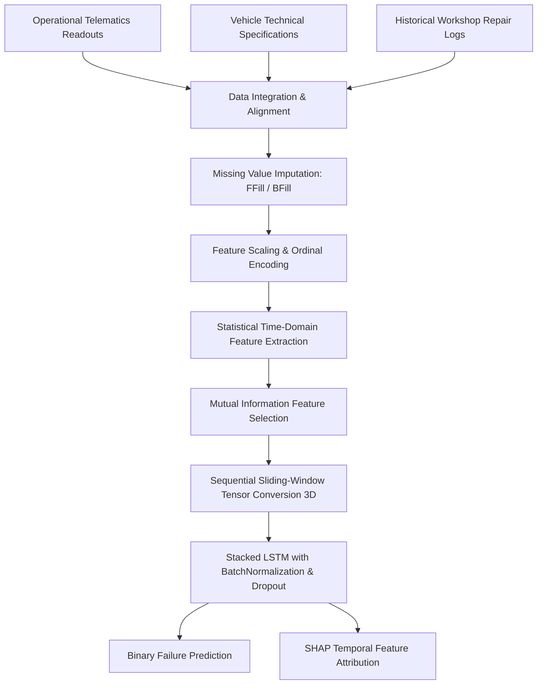

# 🚛 Scania Heavy Vehicle Predictive Maintenance: Deep LSTM & SHAP Explainability

[](https://www.python.org/)
[](https://www.tensorflow.org/)
[](https://scikit-learn.org/)
[](https://shap.readthedocs.io/)
[](LICENSE)

An end-to-end industrial predictive maintenance pipeline predicting imminent component and Air Pressure System (APS) failures in **Scania heavy commercial vehicles**. The pipeline merges multi-source operational telematics, vehicle specifications, and historical repair logs, converting multivariate sensor streams into temporal 3D tensors for training deep **Long Short-Term Memory (LSTM)** networks with **SHAP interpretability**.

---

## 📌 Problem Background & Impact

In fleet logistics and heavy transport, unexpected in-service vehicle breakdowns incur severe financial penalties, towing costs, and secondary mechanical damage. By continuously analyzing high-dimensional operational telemetry readouts, early-stage component wear can be flagged prior to catastrophic failure, optimizing workshop scheduling and minimizing fleet downtime.

---

## 🛠️ Data Pipeline & Architecture



### 1. Data Ingestion & Harmonization
* Integrates three asynchronous datasets:
  * `train_operational_readouts.csv`: Continuous sensor measurements across operational driving cycles.
  * `train_specifications.csv`: Vehicle model variants, axle configurations, and engine ratings.
  * `train_repair_logs.csv`: Ground-truth workshop repair dates and component replacement records.

### 2. Feature Engineering & Selection
* **Statistical Time-Domain Extraction:** Computes rolling statistics (mean, variance, peak amplitude, kurtosis) across continuous sensor channels.
* **Mutual Information (MI) Ranking:** Filters out redundant or uninformative sensor variables to maximize signal-to-noise ratio and prevent overfitting.
* **Sequential Windowing:** Transforms flat 2D tabular records into 3D tensors of shape `(samples, timesteps, features)` for recurrent state modeling.

---

## 🧠 Deep Learning Architecture

The predictive maintenance model employs a stacked recurrent architecture built in **TensorFlow/Keras**:

* **Input Layer:** 3D Tensor `(Batch Size, Timesteps, Selected Sensor Features)`
* **Layer 1 - LSTM:** 64 hidden units with `return_sequences=True` capturing long-range temporal dependencies.
* **Regularization:** `BatchNormalization()` layer to stabilize internal covariate shift followed by `Dropout(0.3)` to avoid co-adaptation.
* **Layer 2 - LSTM:** 32 hidden units extracting high-level sequential failure signatures.
* **Dense Head:** Fully-connected dense layer with ReLU activation.
* **Classification Output:** Sigmoid unit predicting failure probability $P(\text{failure} \mid \mathbf{X}_{t-T:t})$.
* **Loss & Optimizer:** Binary Cross-Entropy trained with the Adam optimizer and learning rate scheduling.

---

## 🔍 Model Interpretability via SHAP

Black-box predictions are unacceptable in safety-critical fleet operations. The pipeline integrates **KernelSHAP / DeepSHAP** to compute Shapley values:
* Quantifies the marginal contribution of each physical sensor parameter to individual failure alarms.
* Highlights primary telemetry root causes (e.g., anomalous pressure gradients, thermal thresholds) for diagnostic technician review.

---

## 📁 Repository Structure

```
MLProject/
├── Scania_Predictive_Maintenance_LSTM.ipynb   # Complete executable Jupyter notebook
├── .gitignore                                 # Ignore data, checkpoints, and venvs
└── README.md                                  # Project overview and documentation
```

---

## 🚀 Getting Started

### Prerequisites
* Python 3.9+
* GPU support recommended for training (NVIDIA CUDA) or run on Google Colab / Kaggle.

### Installation
```bash
git clone https://github.com/23051921/MLProject.git
cd MLProject

pip install numpy pandas scikit-learn tensorflow matplotlib shap
```

### Execution
Run the notebook locally or upload to Google Colab:
```bash
jupyter notebook Scania_Predictive_Maintenance_LSTM.ipynb
```
